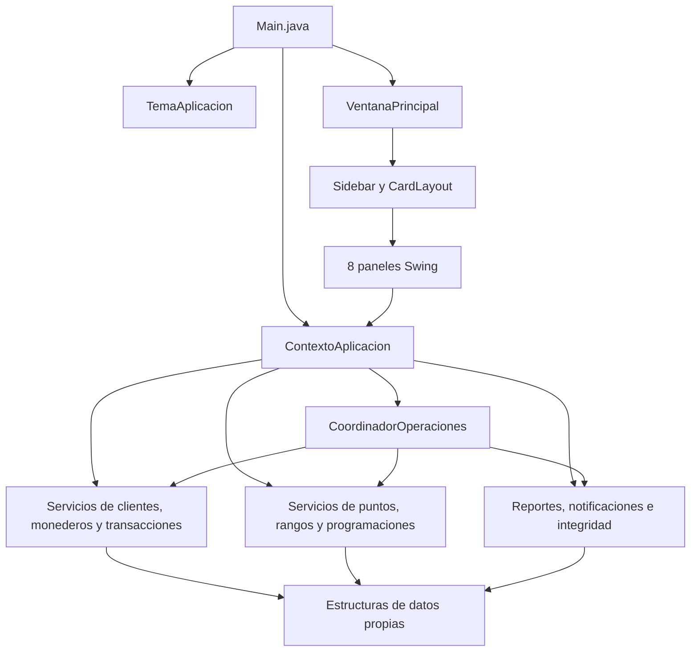
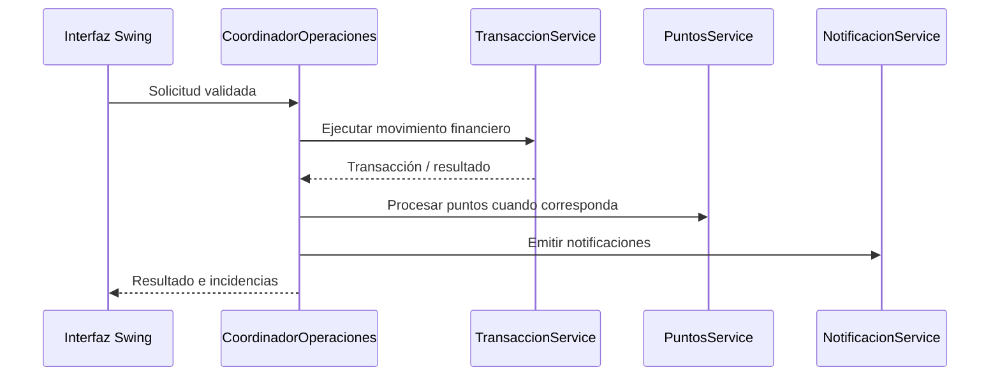

<div align="center">

# MONEDERO / PRIVATE LEDGER

**Simulador de monedero virtual con sistema de puntos**

*Institutional Noir · Proyecto final de Estructuras de Datos · Java 21 + Swing*


**Aplicación de escritorio para administrar clientes, múltiples monederos y operaciones financieras simuladas, con recompensas, rangos, transferencias programadas, reportes y auditorías de integridad.**

</div>

> **Aviso:** este software es un **simulador académico**, no una plataforma bancaria, ni una billetera de dinero real. No procesa pagos externos ni debe utilizarse para custodiar fondos. Los datos se administran en memoria y no persisten al cerrar la aplicación.

## Contenido

- [Descripción](#descripción)
- [Características](#características)
- [Tecnologías y requisitos](#tecnologías-y-requisitos)
- [Inicio rápido (Windows / PowerShell)](#inicio-rápido-windows--powershell)
- [Ejecución normal y demostración](#ejecución-normal-y-demostración)
- [Guía de uso](#guía-de-uso)
- [Estructura del repositorio](#estructura-del-repositorio)
- [Arquitectura](#arquitectura)
- [Estructuras de datos y algoritmos](#estructuras-de-datos-y-algoritmos)
- [Sistema de puntos y beneficios](#sistema-de-puntos-y-beneficios)
- [Operaciones programadas](#operaciones-programadas)
- [Interfaz y recursos visuales](#interfaz-y-recursos-visuales)
- [Pruebas](#pruebas)
- [Limitaciones conocidas](#limitaciones-conocidas)
- [Solución de problemas](#solución-de-problemas)
- [Colaboración y licencia](#colaboración-y-licencia)

## Descripción

**MONEDERO / PRIVATE LEDGER** es un proyecto académico de **Estructuras de Datos** desarrollado con **Java 21** y **Java Swing**. Su propósito es demostrar cómo diferentes estructuras implementadas en el proyecto pueden resolver problemas concretos de administración financiera simulada: búsqueda por identificador, historial de movimientos, reversión de operaciones, programación por fecha, clasificación por puntos y relaciones entre clientes.

La aplicación separa **modelos**, **estructuras**, **servicios**, **interfaz** y **pruebas**. Todas las pantallas utilizan un único `ContextoAplicacion`, que proporciona las mismas instancias de los servicios del sistema. Las operaciones financieras se ejecutan en `TransaccionService`, mientras que `CoordinadorOperaciones` integra sus efectos en puntos, beneficios y notificaciones.

## Características

| Módulo | Funcionalidades |
|---|---|
| **Overview** | Balance consolidado, conteos de clientes, monederos, operaciones, puntos y acciones rápidas. |
| **Clientes** | Registro, búsqueda, consulta y gestión de clientes. |
| **Monederos** | Administración de monederos por cliente, saldos y estados. |
| **Transacciones** | Depósitos, retiros, transferencias y gestión de movimientos financieros. |
| **Puntos y rangos** | Acumulación, consulta, clasificación y canje de beneficios. |
| **Historial** | Consulta de transacciones registradas. |
| **Programadas** | Programación, pausa, reanudación, cancelación, reprogramación y ejecución de operaciones vencidas. |
| **Reportes** | Consultas, resúmenes y verificaciones de integridad. |

Otras capacidades implementadas en los servicios incluyen notificaciones, reversión de operaciones, grafos de transferencias, ranking de clientes y conciliación de saldos.

## Tecnologías y requisitos

- **Java Development Kit (JDK) 21**, con `java` y `javac` disponibles desde la terminal.
- **Java Swing / AWT / Java2D** para la interfaz de escritorio.
- **Windows 10/11 + PowerShell** para los comandos de inicio documentados a continuación. También puede compilarse en otros sistemas con Java 21 y entorno gráfico, adaptando los comandos.
- **IntelliJ IDEA** opcional: el archivo `.idea/` incluido indica configuración de desarrollo en ese IDE; también puede abrirse en VS Code u otro editor Java.
- **No hay dependencias Maven o Gradle declaradas** en el contenido recibido. El proyecto se compila directamente con `javac`.
- Para iniciar la ventana se necesita **un entorno gráfico**; no funciona la interfaz en modo *headless*.

### Comprobar el entorno

En PowerShell:

```powershell
java -version
javac -version
```

Ambos comandos deben indicar una instalación compatible con **Java 21**. Si `javac` no se reconoce, instala un **JDK** (no solo un JRE) y configura `PATH` / `JAVA_HOME`.

## Inicio rápido (Windows / PowerShell)

### 1. Obtener el proyecto

Descarga o clona el repositorio y abre PowerShell en la carpeta que contiene `src/` y `instalar_recursos_monedero.ps1`.

```powershell
# Solo si el proyecto está alojado en Git: sustituye la URL por la real.
# git clone https://github.com/USUARIO/REPOSITORIO.git
# cd REPOSITORIO

# Comprueba que estás en la raíz correcta:
Test-Path .\src\Main.java
```

El último comando debe devolver `True`.

### 2. Compilar todos los archivos Java

```powershell
New-Item -ItemType Directory -Force -Path .\out | Out-Null

$archivos = Get-ChildItem .\src -Recurse -Filter *.java |
    ForEach-Object { $_.FullName }

javac -encoding UTF-8 -d out $archivos

if ($LASTEXITCODE -ne 0) {
    throw 'La compilación falló. Revisa los mensajes de javac.'
}
```

### 3. Copiar los recursos al classpath

`javac` **no copia** imágenes, fuentes ni iconos automáticamente. La interfaz utiliza los archivos de `src/recursos/` y debe poder encontrarlos también al ejecutarse desde `out/`.

```powershell
Copy-Item .\src\recursos .\out -Recurse -Force
```

### 4. Ejecutar la aplicación

```powershell
# Inicia sin datos precargados
java -cp out Main

# O inicia el escenario de demostración
java -cp out Main --demo
```

**Recomendación para la primera ejecución:** utiliza `--demo` para explorar inmediatamente todas las secciones con datos de ejemplo.

### Comando completo para copiar y pegar

```powershell
New-Item -ItemType Directory -Force -Path .\out | Out-Null
$archivos = Get-ChildItem .\src -Recurse -Filter *.java |
    ForEach-Object { $_.FullName }
javac -encoding UTF-8 -d out $archivos
if ($LASTEXITCODE -eq 0) {
    Copy-Item .\src\recursos .\out -Recurse -Force
    java -cp out Main --demo
} else {
    Write-Host '[ERROR] No fue posible compilar.' -ForegroundColor Red
}
```

### Alternativa: Linux / macOS (shell)

```bash
mkdir -p out
find src -name '*.java' -print0 | xargs -0 javac -encoding UTF-8 -d out
cp -R src/recursos out/
java -cp out Main --demo
```

> Los comandos anteriores requieren ejecutarse **desde la raíz del proyecto**. No es necesario ejecutar los instaladores de fuentes e iconos si `src/recursos/` ya contiene los archivos incluidos en el repositorio.

## Ejecución normal y demostración

El punto de entrada es **`src/Main.java`**, clase `Main` en el paquete predeterminado.

| Comando | Comportamiento |
|---|---|
| `java -cp out Main` | Crea los servicios, ejecuta la auditoría inicial y abre la interfaz **sin datos de demostración**. |
| `java -cp out Main --demo` | Registra un escenario utilizando los **servicios reales**, realiza la auditoría y abre la interfaz con información precargada. |

**Escenario de demostración definido en `Main.java`:**

- **3 clientes:** Juan (`C001`), Ana (`C002`) y Luis (`C003`).
- **3 monederos:** `M001`, `M002` y `M003`.
- **5 transacciones:** tres depósitos, una transferencia y un retiro.
- **1 depósito programado** para una fecha futura (tres días después de iniciar la demo).

El resumen de la demostración, según la implementación y la ejecución comprobada, es:

```text
Modo: DEMOSTRACION
Clientes: 3
Monederos: 3
Transacciones: 5
Puntos acumulados: 2200
Saldo consolidado: 174900.00
Programaciones: 1
```

Las transacciones del escenario de prueba pasan por `CoordinadorOperaciones`; **no son filas de interfaz inventadas**.

## Guía de uso

1. **Inicia el programa** con `java -cp out Main --demo` y espera la ventana principal.
2. **Overview:** consulta el saldo total, las estadísticas y los accesos a nueva operación, depósito, retiro y transferencia.
3. **Clientes:** revisa los registros existentes o registra nuevos clientes.
4. **Monederos:** consulta los monederos asociados a cada cliente y sus saldos.
5. **Transacciones:** selecciona un tipo de operación, completa los datos requeridos y ejecuta la operación simulada.
6. **Puntos y rangos:** consulta los puntos del cliente, su clasificación y los beneficios disponibles.
7. **Historial:** revisa los movimientos registrados en la sesión.
8. **Programadas:** crea operaciones futuras, modifica su estado y ejecuta las operaciones vencidas desde las funciones disponibles en el módulo.
9. **Reportes:** consulta resúmenes operativos y auditorías.

### Navegación por teclado

| Atajo | Sección |
|---|---|
| `Ctrl + 1` | Overview |
| `Ctrl + 2` | Clientes |
| `Ctrl + 3` | Monederos |
| `Ctrl + 4` | Transacciones |
| `Ctrl + 5` | Puntos y rangos |
| `Ctrl + 6` | Historial |
| `Ctrl + 7` | Programadas |
| `Ctrl + 8` | Reportes |
| `F5` | Actualizar la sección visible |

La barra lateral puede expandirse o contraerse. La actualización de las pantallas se realiza mediante `refrescarDatos()` y utiliza el contexto compartido.

## Estructura del repositorio

```text
ProyectoFinal/
├── src/
│   ├── Main.java                       # Entrada: modo normal y --demo
│   ├── estructuras/                    # Implementaciones académicas propias
│   │   ├── ArbolAVL.java
│   │   ├── ArbolBinario.java
│   │   ├── Cola.java
│   │   ├── ColaPrioridad.java
│   │   ├── GrafoDirigido.java
│   │   ├── ListaCircular.java
│   │   ├── ListaEnlazada.java
│   │   ├── Nodo.java
│   │   ├── NodoDoble.java
│   │   ├── Pila.java
│   │   └── TablaHash.java
│   ├── modelo/                          # Entidades y reglas básicas
│   │   ├── Beneficio.java
│   │   ├── Cliente.java
│   │   ├── Monedero.java
│   │   ├── Notificacion.java
│   │   ├── Rango.java
│   │   ├── TipoTransaccion.java
│   │   ├── Transaccion.java
│   │   └── TransaccionProgramada.java
│   ├── servicios/                       # Lógica de aplicación
│   │   ├── ClienteService.java
│   │   ├── ContextoAplicacion.java
│   │   ├── CoordinadorOperaciones.java
│   │   ├── IntegridadService.java
│   │   ├── MonederoService.java
│   │   ├── NotificacionService.java
│   │   ├── ProgramacionService.java
│   │   ├── PuntosService.java
│   │   ├── RangosService.java
│   │   ├── ReporteService.java
│   │   └── TransaccionService.java
│   ├── vista/
│   │   ├── PanelInicio.java
│   │   ├── PanelClientes.java
│   │   ├── PanelMonederos.java
│   │   ├── PanelTransacciones.java
│   │   ├── PanelPuntos.java
│   │   ├── PanelHistorial.java
│   │   ├── PanelProgramadas.java
│   │   ├── PanelReportes.java
│   │   ├── VentanaPrincipal.java
│   │   ├── componentes/                # Sidebar, BotonPremium, tablas, etc.
│   │   └── tema/                       # Paleta, tipografía y espaciado
│   ├── pruebas/                         # Pruebas ejecutables desde main()
│   └── recursos/
│       ├── fuentes/                     # 9 archivos .ttf
│       ├── iconos/                      # 24 archivos .svg
│       ├── imagenes/
│       │   └── montanas_monocromo.jpg
│       └── LEEME_RECURSOS.txt
├── out/                                  # Compilados (regenerables)
├── documentacion/                        # Carpeta disponible para informes
├── instalar_recursos_monedero.ps1
└── reparar_recursos_monedero.ps1
```

El archivo comprimido inspeccionado contiene **57 archivos `.java`**. La carpeta `out/` es de salida: se puede regenerar compilando desde `src/`. El directorio `.idea/` corresponde a metadatos locales de IntelliJ IDEA.

## Arquitectura



**Responsabilidades:**

- **`modelo`** define clientes, monederos, transacciones, puntos, rangos y beneficios.
- **`estructuras`** contiene las implementaciones del curso, independientes de la interfaz.
- **`servicios`** concentra reglas de negocio, consultas, coordinación y auditoría.
- **`vista`** presenta datos y envía acciones mediante componentes Swing; no debe modificar balances por su cuenta.
- **`ContextoAplicacion`** evita que cada panel instancie sus propios servicios financieros.

### Flujo de una operación



El coordinador **no garantiza una transacción atómica** entre todos los servicios: si una operación secundaria falla después del movimiento monetario, registra la incidencia sin repetir automáticamente la operación financiera.

## Estructuras de datos y algoritmos

| Estructura | Uso en el sistema | Objetivo |
|---|---|---|
| `TablaHash` | Índices de clientes, transacciones y programaciones | Recuperar registros por identificador sin recorrer todo el historial. |
| `ListaEnlazada` | Orden de clientes, historiales y registros de programaciones | Mantener secuencias y recorridos dinámicos. |
| `ListaCircular` | Notificaciones | Recorrido circular de avisos. |
| `Pila` | Reversiones | Consultar/revertir operaciones siguiendo el principio LIFO. |
| `Cola` | Procesamiento secuencial | Gestionar elementos en orden FIFO. |
| `ColaPrioridad` | Operaciones programadas | Priorizar la siguiente ejecución por fecha. |
| `ArbolBinario` (ABB) | Índices y consultas de puntuaciones | Búsqueda ordenada y comparación académica. |
| `ArbolAVL` | Puntuaciones y ranking | Mantener un árbol balanceado mediante rotaciones. |
| `GrafoDirigido` | Transferencias entre clientes | Representar emisores, receptores, aristas y caminos. |
| `Nodo` y `NodoDoble` | Soporte interno | Enlazar elementos de las estructuras. |

**Complejidades orientativas**, sujetas a la implementación concreta y distribución de los datos:

| Operación | Complejidad típica |
|---|---|
| Tabla hash: buscar/insertar | `O(1)` promedio; `O(n)` en el peor caso. |
| Lista enlazada: recorrer/buscar | `O(n)`. |
| Pila/cola: insertar o extraer en extremos adecuados | `O(1)`. |
| ABB: buscar/insertar | `O(log n)` promedio en árboles razonablemente distribuidos; `O(n)` si se degeneran. |
| AVL: buscar/insertar | `O(log n)` por balanceo. |
| Grafo: recorrido de vértices y aristas | `O(V + E)` en representaciones de adyacencia apropiadas. |

Estas son **cotas teóricas de referencia**, no resultados de un *benchmark* del proyecto. Para afirmar un rendimiento medido se requerirían pruebas instrumentadas con volúmenes controlados.

## Sistema de puntos y beneficios

La acumulación está definida en `modelo/TipoTransaccion.java` y calculada en `Transaccion.calcularPuntosBase()`. Se utilizan **bloques completos de 100 unidades monetarias**:

```text
puntos = floor(monto / 100) × multiplicador_del_tipo
```

| Operación | Puntos por cada 100 unidades | Ejemplo |
|---|---:|---|
| Depósito | 1 | Depósito de 10 000 → 100 puntos. |
| Retiro | 2 | Retiro de 1 000 → 20 puntos. |
| Transferencia | 3 | Transferencia de 20 000 → 600 puntos. |
| Gasto y operaciones especiales | 0 | No generan puntos base. |

**Asignación:** en depósitos, los recibe el titular del monedero de destino; en retiros y transferencias, el cliente de origen. El sistema evita procesar dos veces los puntos de una misma transacción y admite compensación de puntos al revertir operaciones válidas.

### Rangos

| Rango | Puntos acumulados | Descuento de comisión definido en el modelo |
|---|---:|---:|
| Bronce | 0–500 | 0 % |
| Plata | 501–1 000 | 5 % |
| Oro | 1 001–5 000 | 10 % |
| Platino | 5 001 en adelante | 15 % |

Los rangos se calculan en `modelo/Rango.java`. Las reglas aplicables a comisiones dependen del servicio que ejecute la operación y de los beneficios activos.

### Canje de beneficios

| Beneficio | Costo en puntos | Efecto definido |
|---|---:|---|
| Descuento en transferencia | 100 | 10 % de descuento en la comisión de una transferencia. |
| Retiros sin comisión | 500 | Beneficio de 30 días para comisiones por retiro. |
| Bono de saldo | 1 000 | Representa un bono de 50 unidades monetarias. |

> **Importante:** aunque `Beneficio.BONO_SALDO` define un valor monetario, la implementación inspeccionada **no acredita automáticamente ese bono al saldo del monedero**. Esta limitación está reconocida en las pruebas.

### Ejemplo de uso

1. Juan deposita **100 000** unidades: recibe **1 000 puntos**.
2. Canjea **100 puntos** por un beneficio de descuento: queda con **900 puntos**.
3. Realiza una transferencia de **20 000** unidades: recibe **600 puntos**.
4. Termina con **1 500 puntos**, correspondientes al rango **Oro**.
5. Si la comisión original era **1 000**, el descuento canjeado del 10 % la reduce a **900** en el escenario verificado por las pruebas.

La acumulación, la asignación de rangos y la utilización de beneficios se prueban desde las clases de `src/pruebas/`.

## Operaciones programadas

`ProgramacionService` utiliza una **cola de prioridad**, una **tabla hash** y una **lista enlazada** para administrar depósitos y transferencias futuras.

- Frecuencias compatibles: `UNICA`, `DIARIA`, `SEMANAL` y `MENSUAL`.
- Estados: `ACTIVA`, `PAUSADA`, `COMPLETADA` y `CANCELADA`.
- Permite crear, buscar, pausar, reanudar, cancelar y reprogramar operaciones.
- Mantiene un registro de resultados de ejecución y comprueba las fechas antes de procesarlas.

**Importante:** registrar una programación no equivale a dejar instalado un servicio autónomo de ejecución en segundo plano. El servicio proporciona métodos como `ejecutarPendientes()` y `ejecutarProxima()` que deben invocarse para procesar operaciones vencidas. El escenario `--demo` no ejecuta anticipadamente su depósito futuro.

## Interfaz y recursos visuales

La interfaz sigue la identidad **Institutional Noir / Private Ledger**: superficies oscuras, acento champagne, componentes reutilizables y composición editorial.

- **Tipografías:** Inter (interfaz), IBM Plex Mono (cifras e identificadores) e Instrument Serif (títulos). Incluye **9 archivos TTF**.
- **Iconografía:** **24 SVG Lucide** integrados mediante `vista.componentes.IconosLucide` (representación con Java2D, sin biblioteca SVG externa).
- **Imagen:** `src/recursos/imagenes/montanas_monocromo.jpg`, utilizada en la tarjeta de balance de `PanelInicio`.
- **Componentes:** `Sidebar`, `BotonPremium`, `TablaPremium`, `TarjetaEstadistica`, `CampoMonetario` y `EncabezadoPanel`.
- **Sistema visual:** `Paleta`, `Tipografia`, `Espaciado` y `TemaAplicacion`.

### Créditos de recursos

- [Inter](https://github.com/rsms/inter) — familia tipográfica; consultar licencia del proyecto.
- [IBM Plex](https://github.com/IBM/plex) — familia tipográfica; consultar licencia del proyecto.
- [Instrument Serif](https://github.com/google/fonts/tree/main/ofl/instrumentserif) — familia tipográfica; consultar licencia incluida en el origen.
- [Lucide Icons](https://lucide.dev/) — biblioteca de iconos; consultar su licencia.
- [Fotografía de montaña en Unsplash](https://unsplash.com/photos/black-and-white-mountains-under-white-sky-UMLx_wMqnpg) — [Licencia Unsplash](https://unsplash.com/license).

Para más detalles consulta `src/recursos/LEEME_RECURSOS.txt`. Al redistribuir el repositorio, incluye las licencias y avisos requeridos por los autores de los recursos de terceros.

## Pruebas

El proyecto contiene cuatro suites ejecutables directamente, cada una con un método `main()`:

| Suite | Comando | Grupos aprobados | Verificaciones aprobadas |
|---|---|---:|---:|
| Estructuras | `pruebas.PruebaEstructuras` | 11 | 132 |
| Puntos | `pruebas.PruebaPuntos` | 20 | 211 |
| Transacciones | `pruebas.PruebaTransacciones` | 13 | 107 |
| Integración | `pruebas.PruebaIntegracion` | 22 | 253 |

**Resultados:** compilación con `javac` satisfactoria y las cuatro suites ejecutadas exitosamente sobre los archivos del paquete recibido, sin verificaciones fallidas en sus resúmenes.

### Ejecutar todas las suites en PowerShell

```powershell
$pruebas = @(
    'pruebas.PruebaEstructuras',
    'pruebas.PruebaPuntos',
    'pruebas.PruebaTransacciones',
    'pruebas.PruebaIntegracion'
)

foreach ($prueba in $pruebas) {
    Write-Host "`n=== $prueba ===" -ForegroundColor Cyan
    java -cp out $prueba
    if ($LASTEXITCODE -ne 0) {
        throw "Falló la ejecución de $prueba"
    }
}
```

Estas son **pruebas Java ejecutables**, no suites JUnit ni pruebas automatizadas de la interfaz visual. Tampoco certifican el programa para un entorno bancario real.

## Limitaciones conocidas

1. **Datos en memoria:** actualmente no se incluye una capa de persistencia que recupere clientes, movimientos y recompensas después de cerrar el proceso. El modo `--demo` reconstruye el escenario cada vez.
2. **No es un sistema bancario real:** no hay conexión con pasarelas de pago ni cuentas externas.
3. **Atomicidad limitada:** la coordinación entre transacciones, puntos y avisos no ofrece una garantía transaccional integral; las incidencias secundarias se registran.
4. **Bono de saldo pendiente de aplicación financiera:** el beneficio de 50 unidades está modelado, pero no aumenta automáticamente el saldo del monedero.
5. **Programaciones no autónomas:** las operaciones vencidas deben procesarse invocando los métodos correspondientes; no se verificó un servicio independiente de ejecución permanente.
6. **Distribución:** el paquete contiene fuentes y compilados, pero no un instalador de escritorio ni un ejecutable nativo distribuible.
7. **Validación de rendimiento:** las complejidades descritas son principalmente teóricas; no hay un banco de pruebas comparativas con tiempos y memoria documentados.

### Mejoras futuras sugeridas

Persistencia de datos; empaquetado reproducible en JAR o instalador; ejecución automática controlada de operaciones programadas; pruebas GUI; registro estructurado de incidencias; mayor cobertura de errores y evaluación formal de rendimiento.

## Solución de problemas

<details>
<summary><strong>`java` o `javac` no se reconoce</strong></summary>

Instala un JDK 21, configura `JAVA_HOME`, agrega la carpeta `bin` al `PATH` y abre una terminal nueva. Comprueba con `java -version` y `javac -version`.

</details>

<details>
<summary><strong>Error: Could not find or load main class Main</strong></summary>

Ejecuta la terminal desde la raíz del proyecto; verifica que existe `out/Main.class` y usa `java -cp out Main --demo`.

</details>

<details>
<summary><strong>Iconos, fuentes o fotografía ausentes</strong></summary>

Comprueba que `src/recursos` contiene los nueve TTF, los SVG y la imagen JPG. Copia la carpeta nuevamente con `Copy-Item .\src\recursos .\out -Recurse -Force`. Los recursos deben quedar en `out/recursos/`.

</details>

<details>
<summary><strong>El programa abre sin clientes o sin saldo</strong></summary>

Ese es el comportamiento normal de `java -cp out Main`. Para el escenario precargado usa `java -cp out Main --demo`.

</details>

<details>
<summary><strong>No aparece la ventana gráfica</strong></summary>

La aplicación requiere un escritorio con soporte Swing. Revisa las excepciones de consola y evita ejecutarla en entornos sin pantalla (*headless*).

</details>

<details>
<summary><strong>La operación programada no se ejecuta sola</strong></summary>

Las programaciones se registran y se ordenan, pero el servicio necesita una invocación de procesamiento cuando llegue la fecha. Consulta las acciones de la vista **Programadas**.

</details>

## Colaboración y licencia

Este repositorio corresponde a un **proyecto académico**. Para proponer mejoras, crea una rama, conserva las firmas públicas utilizadas por las vistas, añade o actualiza pruebas de las estructuras afectadas y verifica la compilación de todo `src/` antes de integrar cambios.

**Licencia del código:** el archivo comprimido recibido **no contiene un archivo `LICENSE`**. Por tanto, no se declara aquí una licencia de código abierto ni se presupone autorización de redistribución. Si se publica el repositorio, el titular del código debe decidir y añadir la licencia correspondiente. Las fuentes, iconos y fotografías de terceros mantienen sus propios términos de uso.

---

<div align="center">

**MONEDERO / PRIVATE LEDGER · v1.0.0**  
*Estructuras de Datos · Java 21 · Institutional Noir*

</div>
